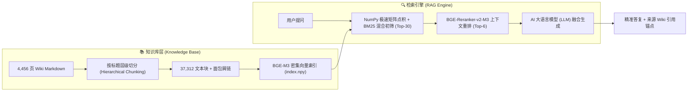

<div align="center">

# 🪄 Noita 中文知识库 · RAG 智能问答系统
### 📚 4,456 页 Wiki 离线镜像 + BM25/向量混合 RAG + 通用 LLM 大模型生成 + MCP / Agent Skill 生态

[](pages/)
[](rag/chunks.json)
[-blueviolet.svg?style=flat-square)](https://huggingface.co/BAAI/bge-m3)
[](https://huggingface.co/BAAI/bge-reranker-v2-m3)
[](https://modelcontextprotocol.io/)
[](https://platform.openai.com/)
[](https://www.python.org/)
[](LICENSE)
[](LICENSE)

[简体中文](./README.md) · [🌟 推荐使用方式](#-推荐使用方式优先) · [🔑 关于 Key 与免费模型说明](#-关于-api-key-与硅基流动免费模型的说明) · [✨ 核心特性](#-核心特性亮点) · [🚀 本地快速部署](#-本地快速部署与运行) · [技术架构](#-技术栈与流水线-pipeline)

</div>

---

## 📖 项目简介

**noita-wiki-zh** 是专为著名 Roguelike 魔法探索神作《Noita》打造的**全量中文离线镜像知识库与本地 RAG 智能问答系统**。

- 📚 **全量离线知识库**：全量爬取并清洗整理的 **4,456 页 Markdown 页面**，站内所有双链均改写为相对路径，可在 VS Code、Obsidian、Typora 中无损离线跳转查阅。
- 🧠 **工业级 RAG 问答体系**：基于 **纯 Python BM25 倒排索引 + BGE-M3 密集向量 (1024维)** + **BGE-Reranker-v2 重排** + **通用 AI 大语言模型（LLM）生成**，回答精准且严格标注 Wiki 来源引用。
- 🔌 **多端极速接入**：支持 **ChatBox 从 GitHub 一键拉取 Skill**、**Windows 脚本一键启动**、**MCP 本地服务部署** 及 **CLI 终端交互**，无缝接入任意主流客户端与大模型。
- ⚡ **开箱即用**：37,312 知识切片与向量索引内置随仓库管理，支持 100% 纯本地离线检索，零依赖极速启动。

---

## 🌟 推荐使用方式（优先）

针对不同需求与使用场景，我们为您推荐以下接入方案：

```
┌─────────────────────────────────────────────────────────────────────────────┐
│ 🥇 推荐方案 1 (最便捷 / 0 门槛)：ChatBox 从 GitHub 一键导入 Skill            │
│ 🥈 推荐方案 2 (最强大 / 深度集成)：MCP Server 本地客户端部署 (run_mcp.bat)   │
│ 🥉 推荐方案 3 (极客 / 纯离线)：CLI 命令行交互与 100% 离线 BM25 检索         │
└─────────────────────────────────────────────────────────────────────────────┘
```
<sub>*(💡 旮旯小提示：其实把本仓库链接直接丢给 AI Agent 去部署才是最简单的 😉)*</sub>

### 🥇 推荐一：ChatBox 从 GitHub 一键导入 Agent Skill（最便捷 / 零本地环境门槛）

如果您使用 [ChatBox](https://chatboxai.app/) 或支持 Agent Skill 的智能体客户端，**无需在本地配置 Python 环境或拉取庞大代码**，即可直接一键加载技能：

1. 打开 ChatBox，进入 **智能体 / Skill 设置**；
2. 选择 **从 Git 仓库添加**，填入本仓库地址：
   ```text
   https://github.com/a1113622001/noita-wiki-zh
   ```
3. 客户端将自动识别 [`skills/noita-wiki-rag/SKILL.md`](./skills/noita-wiki-rag/SKILL.md) 技能规范，即刻在对话中唤起 Noita 知识库问答！

---

### 🥈 推荐二：MCP Server 本地部署（推荐桌面客户端 / IDE 深度联动）

适合将知识库作为标准 MCP 工具挂载到 **ChatBox**、**Claude Code**、**Cursor**、**Cherry Studio** 等客户端中：

1. **克隆仓库与拉取数据**：
   ```bash
   git lfs install
   git clone https://github.com/a1113622001/noita-wiki-zh.git
   cd noita-wiki-zh
   pip install numpy mcp starlette uvicorn
   ```
2. **Windows 用户一键启动**：
   双击根目录下的 [`run_mcp.bat`](./run_mcp.bat)，脚本将自动探测 Python 环境与 UTF-8 编码，即刻拉起 MCP 服务。
3. **ChatBox MCP 配置**：
   在 ChatBox 的 MCP 设置中添加 Stdio 服务，指定命令为 `python`，参数为 `rag/mcp_server.py`，并填入环境变量 `SILICONFLOW_API_KEY`。

👉 **更详细的图文配置与自检步骤请参阅：[`DEPLOY_LOCAL.md`](./DEPLOY_LOCAL.md)**

---

### 🥉 推荐三：CLI 命令行与 100% 纯本地离线检索（无需 API Key）

如果您只想快速查阅法术合成、BOSS 血量或地图机制，甚至无需联网与 API Key：

```bash
# 纯本地离线关键词精确检索 (0 API Key / 0 网络消耗 / 毫秒级返回)
python rag/query.py "黑洞法术怎么配" --no-llm

# 完整 RAG 问答 (打字机流式输出 + 自动引用 Wiki 来源)
python rag/query.py "34魔球boss血量多少"
```

---

## 🔑 关于 API Key 与硅基流动免费模型的说明

在使用 **完整 RAG 智能问答**（向量初筛 + 交叉重排 + LLM 总结）时，需要配置 API Key。在此特别说明技术选型：

> ### 💡 为什么需要硅基流动 (SiliconFlow) Key？
> 
> 1. **免费高质量模型**：本项目为了兼顾**高精度中文语义理解**与**普通用户的零成本使用**，底层向量嵌入（Embedding）采用了 `BAAI/bge-m3`（1024维），上下文重排（Rerank）采用了 `BAAI/bge-reranker-v2-m3`。这两个模型在[硅基流动平台 (siliconflow.cn)](https://siliconflow.cn)均属于**完全免费提供的模型服务**，注册即可获取额度免费调用，无需充值。
> 2. **通用大模型兼容**：大语言模型（LLM）生成部分完全基于标准 OpenAI 兼容协议开发，无论是 SiliconFlow、DeepSeek 官方、Qwen、Claude、GPT 还是本地 Ollama 自建模型均可无缝切换。
> 3. **免 Key 自动降级**：如果您**未填写 API Key**，系统绝不会报错崩溃，而是**自动降级为 100% 纯本地离线 BM25 检索**，依然能毫秒级精确命中 Wiki 词条。
> 
> ---
> 
> 🤝 **【欢迎交流与共建】**  
> 选择硅基流动的免费 BGE 嵌入与重排模型是当前阶段兼顾检索质量与小白门槛的最优解。如果您在实践中有**更优秀、更稳定、高性价比或离线轻量化的模型选型方案**，非常欢迎随时联系作者探讨修改与协同优化！

---

## ✨ 核心特性亮点

- ⚡ **100% 纯本地离线可用**：未配置 API Key 或传入 `--no-llm` 时，自动降级为内置 BM25 倒排索引全文检索，0 外部网络依赖、0 API 费用消耗，即搜即用。
- 🎯 **Dense + Sparse 混合双路召回**：BGE-M3 密集向量与 BM25 稀疏检索通过 RRF (Reciprocal Rank Fusion, $k=60$) 互惠排名融合，大幅提升小众法术代码、怪物代号与精确数值的召回准确率。
- ⏳ **打字机式实时流式输出 (SSE Streaming)**：大模型问答全面支持流式传输，首字感知延迟（TTFT）降低至 **< 300ms**，并在末尾精准附带来源 Wiki 双链锚点。
- 💡 **双层线程安全 LRU 缓存**：Embedding 向量与生成回答自动内存缓存（容量 1024 / 512），高频重复提问实现 **< 1ms 毫秒级即时响应**，节省 100% 重复 API 消耗。
- 🛡️ **生产级安全与异常拦截**：MCP Server 支持 Bearer Token 恒定时间鉴权防时序攻击；全局异常拦截屏障彻底消除外部服务欠费（HTTP 402）、限流（429）或断网时的协议崩溃。
- 🖱️ **Windows 一键极速启动 (`run_mcp.bat`)**：自动探查 Python 3.10+ 环境并配置 UTF-8 编码环境，双击即可无痛拉起 MCP 服务。

---

## 🏗️ 技术栈与流水线 (Pipeline)



### 核心技术选型

| 环节 | 选型与方案 | 技术说明 |
| :--- | :--- | :--- |
| **文档切分** | 标题层级切分 (Hierarchical) | 保留上级标题上下文链（如 `法术 > 投射物修饰 > 触发机制`），共 37,312 块 |
| **向量嵌入 (Embedding)** | `BAAI/bge-m3` (硅基流动免费) | 1024 维密集多语言向量表示 |
| **初筛检索** | 密集向量余弦相似度 + BM25 倒排索引 | 毫秒级内存矩阵点积与 RRF 融合召回 Top-30 相关切片 |
| **精排重排 (Rerank)** | `BAAI/bge-reranker-v2-m3` (硅基流动免费) | 交叉编码重排打分，精选输出 Top-6 最佳上下文 |
| **大模型生成** | OpenAI 兼容接口 / 任意通用 LLM | 支持通用 LLM、开源模型或各主流 AI 服务 |

---

## 🚀 本地快速部署与运行

### 1. 克隆仓库 (需支持 Git LFS)
```bash
git lfs install
git clone https://github.com/a1113622001/noita-wiki-zh.git
cd noita-wiki-zh
```

### 2. 安装依赖
```bash
pip install numpy mcp starlette uvicorn
```

### 3. 配置 API Key (仅问答生成需要，纯检索无需配置)
复制配置模板并填入您的 API Key（推荐硅基流动免费 Key 或任意兼容 Key）：
```bash
cp rag/config.example.json rag/config.json
```
*或直接设置环境变量：`export SILICONFLOW_API_KEY="sk-..."` (Windows PowerShell: `$env:SILICONFLOW_API_KEY="sk-..."`)*

---

## ⚙️ MCP Server 配置范例 (`mcp.json`)

```json
{
  "mcpServers": {
    "noita-wiki-rag": {
      "command": "python",
      "args": ["rag/mcp_server.py"],
      "cwd": "${workspaceFolder}",
      "env": {
        "PYTHONIOENCODING": "utf-8",
        "SILICONFLOW_API_KEY": "sk-your-api-key"
      }
    }
  }
}
```

---

## 📖 离线知识库查阅

- **全量分类索引**：直接打开根目录 [`index.md`](./index.md) 查看按游戏机制、法术、生物、生物群系组织的目录树；
- **标题映射表**：查看 [`title_to_file.json`](./title_to_file.json) 获取 4,456 个 Wiki 中文条目与 Markdown 文件的精确映射；
- **知识库正文**：所有正文 Markdown 文件均位于 [`pages/`](./pages/) 目录下。

---

## 📁 目录结构

```
noita-wiki-zh/
├── index.md                   # 📚 全量页面分类索引
├── title_to_file.json         # 🗺️ 页面标题 → Markdown 文件名映射
├── pages/                     # 📂 4,456 页 Markdown 离线镜像知识库
├── run_mcp.bat                # ⚡ Windows 一键无痛启动脚本
├── DEPLOY_LOCAL.md            # 📖 本地部署与 ChatBox 详细接入指南
├── RELEASE_NOTES.md           # 📝 版本更新日志 (Changelog)
├── REPORT_P2_DELIVERY.md      # 📦 Milestone v1.1 核心交付报告
├── project_debate_report.md   # 🏛️ 三方辩论与推演裁决报告
├── skills/
│   └── noita-wiki-rag/        # 🤖 Agent Skill 规范目录 (SKILL.md)
├── rag/
│   ├── build_index.py         # 索引构建脚本 (切片 + BGE 向量生成)
│   ├── chunks.json            # 37,312 知识切片库 (Git LFS)
│   ├── index.npy              # BGE 密集向量索引 (Git LFS)
│   ├── query.py               # RAG 问答检索核心入口 (CLI, 支持 BM25+SSE)
│   ├── mcp_server.py          # 标准 Model Context Protocol 服务端 (带 Bearer 鉴权)
│   └── config.example.json    # 配置文件模板
├── tests/
│   ├── test_p1_fixes.py       # P0/P1 回归测试套件
│   └── test_p2_features.py    # Phase 2 核心功能测试套件 (73/73 通过)
├── mcp.chatbox.json.example   # ChatBox MCP 配置范例
└── mcp.local.json.example     # 本地 MCP 配置范例
```

---

## 📄 开源许可说明

- **知识库正文内容**：版权归 Noita Wiki 贡献者所有，遵循 [知识共享 署名-非商业性使用-相同方式共享 3.0 (CC BY-NC-SA 3.0)](https://creativecommons.org/licenses/by-nc-sa/3.0/deed.zh-hans) 许可；
- **RAG 系统与工程代码**：`rag/` 及 `skills/` 下的检索算法与服务端代码均按 [MIT License](LICENSE) 授权开源。

> 💡 *免责声明：本仓库由 AI 辅助整理与维护，游戏机制复杂多变，重要机制信息建议以 [Noita Wiki (zh)](https://noita.wiki.gg/zh) 官方站或游戏最新版本实测为准。*
